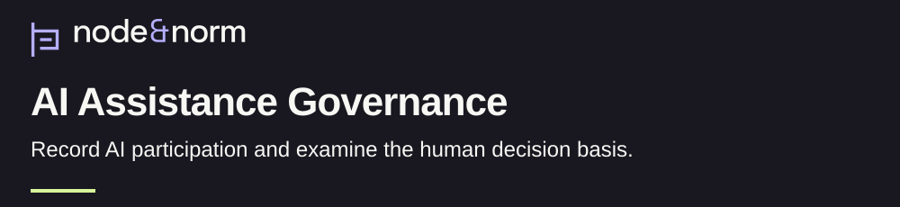

> **Research status, as of November 11, 2026: Working method/profile.**
>
> **What this repository holds.** A method for recording AI participation and examining the human basis of a decision, with a hypothetical example and selected contract checks.
>
> **What remains open.** Qualified application, independent assessment and field effectiveness remain open. Structural completeness does not establish substantive independence.

<h1>
<picture>
  <source media="(max-width: 600px)" srcset="assets/research/v1/banner-mobile-dark.svg">
  
</picture>
</h1>

[](CITATION.cff) [](CITATION.cff) [](LICENSE)

Can a reviewer reconstruct the human basis of a decision that involved AI? This working method records AI participation and separates record completeness from substantive review of the decision's evidence. [AI Dependency Test](docs/ai-dependency-test.md).

[Policy reader: understand in 90 seconds](#research-in-90-seconds) · [Reviewer: inspect the method](#method-and-evidence) · [Engineer: run the checks](docs/reference-verification.md)

## At a glance

| | Current account |
| :--- | :--- |
| Purpose | Make AI participation and the human decision basis inspectable. [Method](docs/ai-dependency-test.md) |
| Status | Working method/profile. Independent review and field effectiveness remain open. [Status record](docs/remediation-report.md) |
| Evidence type | Method documentation, a hypothetical example and selected contract checks. [Example](examples/rgds-dec-0003-ai-assisted-conditional-go.md), [validation scope](docs/validation.md) |
| Version | v1.1.0, September 10, 2026. [Citation metadata](CITATION.cff), [release](https://github.com/node-and-norm/rgds-ai-governance/releases/tag/v1.1.0) |
| License | [Apache-2.0](LICENSE), with existing [attribution](NOTICE). |
| Cite | [Citation metadata](CITATION.cff). No DOI is assigned. |

## Research in 90 seconds

A decision record can name an approver while leaving the basis for the judgment unclear. This profile asks the reviewer to identify what AI contributed and which independent sources support the material reasons for the decision. [Dependency method](docs/ai-dependency-test.md).

The contribution is a two-part assessment. First, retain the complete record and check its required structure. Then ask a qualified reviewer whether the material rationale can be reconstructed from non-AI sources. Each part receives its own result. [Procedure](docs/ai-dependency-test.md).

Six governance covenants define the proposed adoption requirements. They cover bounded AI tasks, assigned human authority, explicit invocation, review, risk acceptance and evidence. The repository documents these requirements; an adopting organization must implement and assess them. [Contract](contracts/non-agentic-ai-contract.md).

## Method and evidence

The AI Dependency Test excludes model output from the evidentiary basis while preserving the original record and its truthful AI disclosure. Deleting the disclosure would remove part of the history under examination. [Method](docs/ai-dependency-test.md), [pinned contract check](scripts/check_rgds_contract.py).

| Material | Available evidence | Remaining review |
| :--- | :--- | :--- |
| Working method | Two-part dependency procedure and six covenants. [Procedure](docs/ai-dependency-test.md), [contract](contracts/non-agentic-ai-contract.md) | Qualified application and independent assessment remain open. [Status](docs/remediation-report.md) |
| Hypothetical example | An illustrative AI-assisted conditional decision. [Example](examples/rgds-dec-0003-ai-assisted-conditional-go.md) | Structural assessment is unperformed; substantive independence is indeterminate. [Example status](examples/rgds-dec-0003-ai-assisted-conditional-go.md) |
| Technical checks | Local documentation checks and selected RGDS v2.0.1 contract conditions. [Validation](docs/validation.md) | Source truth, reviewer competence and practical influence require separate evidence. [Contract checker](scripts/check_rgds_contract.py) |
| Framework crosswalk | Interpretive mappings to external frameworks. [Crosswalk](docs/framework-crosswalk.md) | Applicability, legal conformity and control effectiveness need context-specific review. [Crosswalk limits](docs/framework-crosswalk.md) |

The repository sits between a general architecture and a reference implementation. [Governed Decision Intelligence](https://github.com/node-and-norm/governed-decision-intelligence) supplies the architectural context. [RGDS v2.0.1](https://github.com/node-and-norm/rgds/tree/f6fa066c7e53d1d89d68ac8ef424b559ef58be34) supplies the inspected contract. The [independent study](https://github.com/node-and-norm/rgds-independent-study) provides separate exploratory context. These relationships describe conceptual roles. [Architecture and scope](README-2026-11-03.md#architecture-and-scope).

## Known limits

A structurally valid record can contain fabricated or unexamined claims. The method therefore leaves evidence access, reviewer competence, time, institutional authority and actual intervention to separate assessment. Field effectiveness remains unestablished. [Limits and open gates](docs/remediation-report.md).

The earlier removability account remains available under its supersession notice. The current method distinguishes record completeness from substantive independence. [Preserved historical text](docs/ai-removability-proof.md), [current test](docs/ai-dependency-test.md).

## Reproduce the checks

The [verification guide](docs/reference-verification.md) gives exact commands and expected output. The documentation check uses Python 3.9 or later. The contract check uses a clean RGDS checkout at commit `f6fa066c7e53d1d89d68ac8ef424b559ef58be34` and `jsonschema[format]==4.25.1`. [Existing requirements and scope](docs/validation.md), [CI environment](.github/workflows/validate.yml).

## AI assistance and human review

Codex assisted the recorded remediation through repository inspection, drafting and validation scripts. The owner authorized its merge and release. Independent review and substantive field validation remain open. [Remediation record](docs/remediation-report.md).

Codex also prepared this navigation draft and its verification guide. The present design review concerns presentation and navigation. It leaves the method's evidence status and human-review limits as recorded. [Preserved baseline](https://github.com/node-and-norm/rgds-ai-governance/tree/0b2dd5bd9af964ffa90ddb4007ea4bbef94f52d8).

## Cite the method

This entry renders the existing identity in [CITATION.cff](CITATION.cff). Its software category describes the repository package; the research object is a working method/profile. [Citation explanation](docs/validation.md#human-review-and-preservation).

```bibtex
@software{banasihan2026aiassistance,
  author = {Banasihan, Mark Julius},
  title = {AI Assistance Governance: A Working Method/Profile for Bounded AI Participation},
  year = {2026},
  month = sep,
  version = {1.1.0},
  url = {https://github.com/node-and-norm/rgds-ai-governance},
  note = {Released September 10, 2026. No DOI assigned}
}
```

<details>
<summary>Complete prior entry and technical documents</summary>

The [prior README](README-2026-11-03.md) preserves the complete entry at [audit commit 0b2dd5b](https://github.com/node-and-norm/rgds-ai-governance/tree/0b2dd5bd9af964ffa90ddb4007ea4bbef94f52d8).

- [Non-agentic assistance contract](contracts/non-agentic-ai-contract.md)
- [Conceptual decision architecture](docs/ai-governance-conceptual-decision-architecture.md)
- [What AI will not do](docs/what-ai-will-not-do.md)
- [Framework crosswalk](docs/framework-crosswalk.md)
- [Change history](CHANGELOG.md)

</details>
